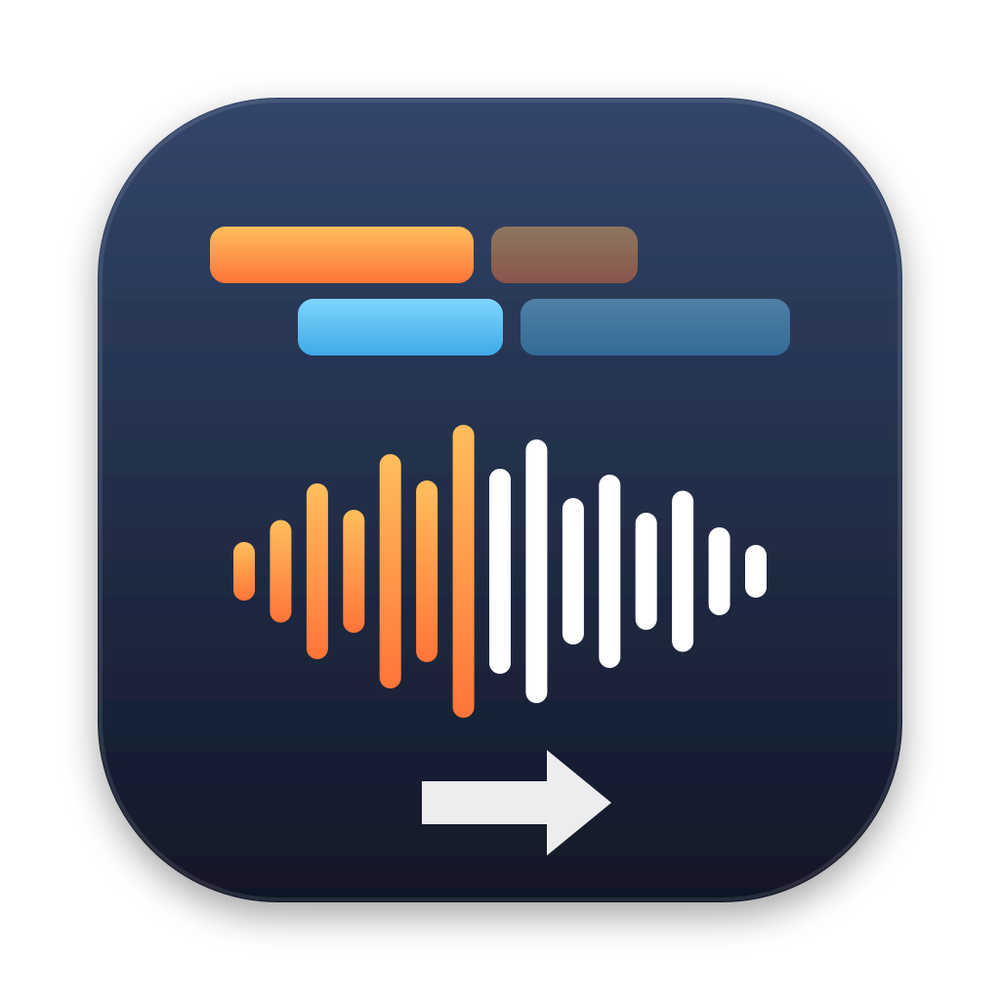

# AAF to Reaper

Turns an AAF exported from **DaVinci Resolve** (also Avid, Premiere, Pro Tools) into a **REAPER** project.
No plug-ins and no extra libraries: just Python 3.

## Download

- **[AAF-to-Reaper-Mac.zip](https://github.com/sarcman/aaf-to-reaper/raw/main/downloads/AAF-to-Reaper-Mac.zip)**: Apple Silicon and Intel
- **[AAF-to-Reaper-Windows.zip](https://github.com/sarcman/aaf-to-reaper/raw/main/downloads/AAF-to-Reaper-Windows.zip)**
- **[Example_AAF.zip](https://github.com/sarcman/aaf-to-reaper/raw/main/downloads/Example_AAF.zip)**: a sample AAF from DaVinci Resolve with its audio, to try it right away

Unzip, then follow the `README.txt` inside ([Mac](MacOS/README.txt), [Windows](Windows/README.txt)).

## How it works

In DaVinci Resolve: **Fairlight > File > Export > Timeline > AAF Files**. Put the AAF and all the audio files it uses in one folder (see [How to export from DaVinci Resolve](How%20to%20export%20from%20DaVinci%20Resolve.txt)). Then:

1. Open the app and choose one or more `.aaf` files.
2. A folder `<AAF name> - Reaper` is created next to the AAF, with the `.RPP` project and a `SoundFiles` folder (audio as WAV).
3. Click **Open in REAPER**.

## What comes across

- Tracks and track names
- Clips: position, length, trims
- Fade-ins, fade-outs, crossfades
- Clip volume (gain)
- Stereo clips (Resolve's separate L/R MXF files become one stereo WAV)
- Start timecode, frame rate, sample rate
- Linked media (MXF, WAV, AIFF) and embedded media
- Full-length audio: when the AAF links to the original WAV files, they are copied whole, so you can extend clips and fades in REAPER

**Not carried over:** track faders and pan (Resolve doesn't export them), plug-ins and effects.

## Requirements

- **Mac:** Python 3 (comes with Apple's Command Line Tools: `xcode-select --install`)
- **Windows:** Python 3 from [python.org](https://www.python.org/downloads/windows/)

The Mac app isn't signed by Apple: the first time, right-click it and choose **Open**.

## License

<a href="LICENSE">CC BY-NC-SA 4.0</a>: free to use, share and modify with credit, not for sale or commercial use. Modified versions must keep the same license.

℗ 2026 Orestis Karamanlis
